# Stealth Contribution Graph

<picture>
  <source media="(prefers-color-scheme: dark)" srcset="https://raw.githubusercontent.com/Egroses/stealth-contribution-graph/output/stealth-dark.svg">
  
</picture>

A GitHub Action that turns a contribution graph into a small stealth level for a profile README. Days with commits become crates, guards patrol the empty days with flashlights, and an intruder crosses the year from the first week to the last without being seen. The level is rebuilt every day from the latest graph.

## How it works

- Days with contributions are crates. They block movement and line of sight. Empty days are floor.
- Guards walk back and forth on the floor and sweep their light when they turn around. The light stops at crates.
- The intruder's route comes from a search over space and time. It can wait at the door, hide behind crates and slip past right behind a guard.
- Before anything is written, the route is replayed in steps of 1/20 against every guard's view cone. If the intruder would be seen at any moment, no image is produced.
- If there is no way from the first week to the last, the lightest crates on the cheapest path become passages, drawn hollow.
- On very busy graphs the quietest days become passages too, so the guards have room to patrol.
- The layout is seeded from the user name and the graph, so the level only changes when the graph does.

Plain Python standard library, no dependencies. The animation is SVG (SMIL), no JavaScript.

## Usage

1. In your profile repository (`<username>/<username>`), add `.github/workflows/stealth.yml`:

   ```yaml
   name: stealth

   on:
     schedule:
       - cron: "0 4 * * *"
     workflow_dispatch:

   permissions:
     contents: write

   jobs:
     build:
       runs-on: ubuntu-latest
       steps:
         - uses: Egroses/stealth-contribution-graph@v1
   ```

2. Run it once from the Actions tab. After that it runs every day and pushes `stealth-dark.svg` and `stealth-light.svg` to an `output` branch.

3. Add this to your README, with your user name in place of `<username>`:

   ```html
   <picture>
     <source media="(prefers-color-scheme: dark)" srcset="https://raw.githubusercontent.com/<username>/<username>/output/stealth-dark.svg">
     /<username>/output/stealth-light.svg">
   </picture>
   ```

## Inputs

| Input | Default | Description |
|---|---|---|
| `github_user_name` | repository owner | Whose contribution graph to use |
| `github_token` | `github.token` | Reads the graph and pushes the images |
| `output_dir` | `dist` | Where the SVG files are written |
| `publish_branch` | `output` | Branch the files are force-pushed to. Leave empty to only generate them |

## Run locally

```bash
GITHUB_TOKEN=$(gh auth token) python3 stealth.py --user <username> --out dist
```

Needs Python 3.9 or newer. A run takes 10 to 60 seconds, depending on the graph.

## Notes

- The `output` branch holds a single commit by `github-actions[bot]` that is replaced on every run. The default branch history stays clean, and these commits do not count toward your graph.
- GitHub caches README images, so a new day's level can take a while to show up.
- Recent Chrome, Firefox and Safari play the animation. Some older clients show only the first frame.

Similar in spirit to [Platane/snk](https://github.com/Platane/snk).

## License

[MIT](LICENSE)
